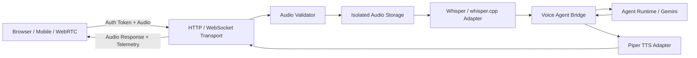

# Voice Runtime — Architecture & Integration Boundary

The `voice-runtime` subsystem provides authenticated, low-latency audio processing for speech-driven AI agent conversations.

---

## 1. Architecture Overview



- **Sessions (`app/sessions`)**: Issues ephemeral cryptographic session tokens (`vst_...`), enforces tenant isolation, handles inactivity timeouts and session state transitions.
- **Audio Validation & Storage (`app/audio`)**: Validates audio MIME types, file sizes (10MB limit), duration caps (60s limit), and inspects magic bytes (RIFF/WAVE, OggS, WebM, MP3). Implements isolated temporary storage with strict deletion policies.
- **Speech-to-Text (`app/stt`)**: Integrates local Whisper or `whisper.cpp` with silence detection and recognition error handling. Includes built-in fallback for environments without model binaries.
- **Text-to-Speech (`app/tts`)**: Integrates Piper ONNX speech synthesis with sample-rate configuration (16kHz PCM WAV) and error resilience.
- **Agent Bridge (`app/agent_bridge`)**: Connects voice sessions to the enterprise `AgentRunner`, routing transcripts with caller permissions and tenant boundaries.
- **Lifecycle & Interruption (`app/lifecycle`)**: Manages session state machine (`CREATED` &rarr; `ACTIVE` &rarr; `LISTENING` &rarr; `PROCESSING` &rarr; `SPEAKING` &rarr; `INTERRUPTED`), handling user barge-in interruptions and cleanup routines.
- **Telemetry (`app/telemetry`)**: Tracks per-turn STT latency, Agent reasoning latency, TTS synthesis latency, and total end-to-end turn time.

---

## 2. Local Hardware Requirements

| Component | Minimum Specification | Recommended Specification | Notes |
| :--- | :--- | :--- | :--- |
| **CPU** | 4 Cores (x86_64 or Apple Silicon) | 8 Cores (AVX2 / NEON support) | AVX2 accelerates Whisper & Piper ONNX inference. |
| **RAM** | 4 GB free memory | 8 GB+ free memory | `whisper.cpp tiny.en` requires ~390 MB; `base.en` requires ~500 MB. |
| **GPU (Optional)** | Not required (CPU inference supported) | NVIDIA CUDA (4GB VRAM) or Apple Metal | Speeds up multi-user concurrent voice sessions. |
| **Disk** | 500 MB free space | 2 GB free space | For whisper models (`ggml-tiny.en.bin`) and Piper voices (`.onnx` + `.json`). |

### Recommended Local Models
- **STT**: `whisper.cpp` with model `ggml-tiny.en.bin` or `ggml-base.en.bin`.
- **TTS**: Piper ONNX model `en_US-lessac-medium.onnx`.

---

## 3. Worker Offload Strategy

For production workloads with concurrent voice users:
1. **Asynchronous Speech Processing**: Run heavy Whisper and Piper synthesis tasks in dedicated background worker processes (e.g. Celery workers or independent streaming worker processes) rather than blocking the main asyncio event loop.
2. **Worker Concurrency**: Configure dedicated CPU core affinity for audio encoding/decoding threads (`OMP_NUM_THREADS=2` per worker).

---

## 4. Security & Privacy Guarantees

- **No Master Keys in Client Code**: Clients receive only short-lived session tokens (`vst_...`) scoped to a single conversation and tenant. Provider keys (Gemini, STT/TTS keys) are never exposed.
- **Ephemeral Audio Storage**: Audio recordings are never persisted to long-term storage unless explicitly configured in tenant debug options. Temporary files are deleted immediately following turn completion.
- **Isolated Directory Permissions**: Temporary scratch files reside in an isolated directory (`.scratch/voice_audio`) with `0700` access permissions.
- **Tenant Boundary Enforcement**: Every session lookup and audio turn asserts tenant boundaries. Cross-tenant queries are blocked with `403 Forbidden`.

---

## 5. Running & Testing

### Run Standalone Voice Runtime Server
```bash
uvicorn app.server:app --port 8001 --reload
```

### Run Unified Backend (with mounted Voice Routes)
```bash
uvicorn app.main:app --port 8000 --reload
```

### Run Test Suite
```bash
pytest voice-runtime/tests/test_voice_runtime.py
```
